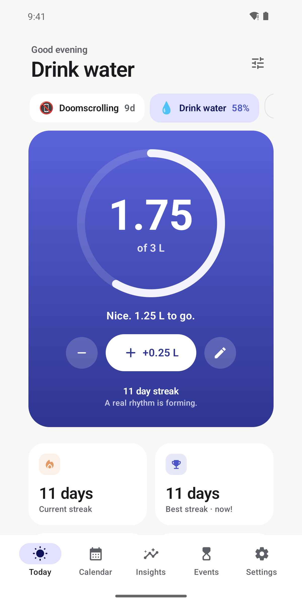
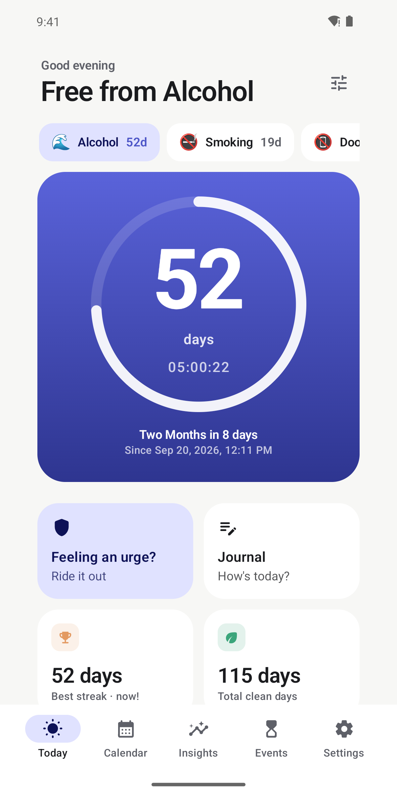
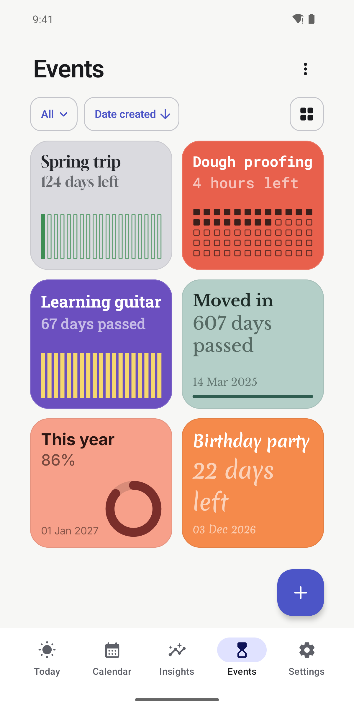
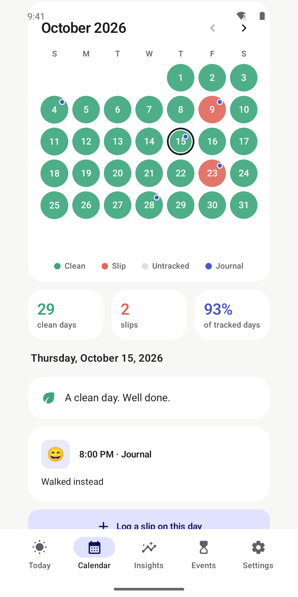
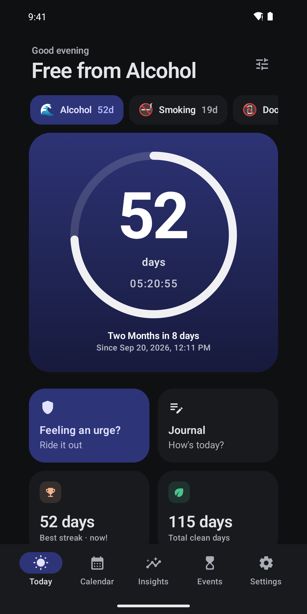

<p align="center">
  
</p>

<h1 align="center">Daymark</h1>

<p align="center">
  Build habits, break habits, count down to what matters.<br>
  A calm, private, offline Android app. No account, no ads, no analytics, no internet permission.
</p>

<p align="center">
  <a href="https://appdrop-store.vercel.app/apps/daymark"><b>Get it on AppDrop</b></a> ·
  <a href="https://appdrop-store.vercel.app/d/daymark">Direct APK download</a> ·
  <a href="../../releases/latest">Latest release</a> ·
  <a href="LICENSE">MIT licence</a>
</p>

<p align="center">
  
  
  
  
  
</p>

Every day you mark is a day you made. A slip or a missed day never erases what you have built: your longest streak, your clean days and your achievements are always kept.

## What it does

**Build a habit.** Water, reading, workouts, meditation and more, or your own. A daily goal with a unit (3 L, 10 pages) or a simple check-off, on every day or a weekly schedule. Reminders every 30 to 180 minutes within the hours you choose, or at fixed times, with log, snooze and skip right in the notification. Streaks count scheduled days only, so rest days never break them.

**Break a habit.** A live streak ticking in days, hours, minutes and seconds, a progress ring toward your next milestone, longest streak and total clean days. Quit outright or cut down with a daily limit. Money kept, your own reasons, urges you rode out, and insights into triggers, time of day, weekday and mood. Twelve milestones from 24 hours to 5 years, earned against your longest streak, with share cards drawn on your phone.

**Slip, or not a slip.** Logging has two choices. *Slip* records date, time, mood, triggers, situation and a note. *Not a slip* saves a private note for something involuntary or something you don't want counted, and never touches your streak.

**Journal and Calendar.** Write on any day with a mood, a gentle prompt and up to three photos that stay inside Daymark. A swipeable calendar shows clean, slip and untracked days, with a badge on every day you journalled.

**Events.** Count down to a date, count the time since a moment, or run a timer. Built-in Today, This week, This month and This year progress, repeats, notes, and about 60 starter ideas with a first-run wizard. Cards come in five designs (Text, Ring, Grid, Bars, Minimal) with ten fonts, custom colours and icons, a live preview, and share-as-image. Optional notifications and an optional one-time import from your calendar.

**Widgets.** Streak, Progress ring, Heatmap, Daily motivation, Quick actions and Your progress for your trackers, plus an Event widget with full, translucent or transparent backgrounds and an "upcoming" mode that shows your next event. Six styles (Dusk, Dawn, Forest, Midnight, Sunrise, Minimal). Press and hold a tracker's circle in the app to add its widget in one step, already set to that tracker.

**Many trackers.** Follow as many as you like. Each keeps its own streaks, calendar, insights and achievements.

## Private by design

- No account, no ads, no analytics, no crash-reporting SDK. The app does not request the `INTERNET` permission, so it cannot send data anywhere.
- Everything lives on your device. Android cloud backup is turned off.
- **Discreet mode** (on by default): widgets, notifications, the Quick Settings tile and share images never name what you track.
- Optional app lock with fingerprint, face or device PIN (handled by Android), and optional "hide in recents".
- Backups are a JSON file you control, optionally password-protected (AES-256-GCM, PBKDF2 key). Optional automatic daily backups go to a folder you pick, keeping the last seven.
- The only extra permissions are notifications for reminders you switch on, and an optional calendar read (`READ_CALENDAR`) that is requested only when you tap "Import from calendar".

Because the code is open, you can check every one of these claims yourself.

## Install

1. Get the APK from [AppDrop](https://appdrop-store.vercel.app/apps/daymark) or the [Releases](../../releases) page.
2. Open it on your phone. You may need to allow *Install unknown apps* for your browser or file manager.
3. Android 8.0 (API 26) or newer is required.

Releases are signed with one fixed key, so each new version installs over the last one and keeps your data. Don't uninstall to update.

## Build from source

```bash
export ANDROID_HOME=~/android-sdk      # your Android SDK
./gradlew testDebugUnitTest            # unit tests (pure Kotlin: domain, backup, events)
./gradlew lintRelease                  # lint, must report 0 errors
./gradlew assembleDebug                # debug APK in app/build/outputs/apk/debug/
```

Debug builds work out of the box and use the standard debug key. Release signing keys and passwords are deliberately not part of this repository. A debug build and a release build have different signatures, so switching between them on one phone needs an uninstall.

## Tech

Kotlin · Jetpack Compose (Material 3) · Room · DataStore · Glance app widgets · WorkManager · BiometricPrompt · kotlinx.serialization.
A single module with manual dependency injection. All streak, milestone, event and insight maths lives in pure Kotlin (`domain/`) and is unit-tested. Cards and widgets share one Canvas renderer, so the in-app preview is exactly what lands on your home screen.

## Project docs

- [docs/MAINTAINING.md](docs/MAINTAINING.md): step-by-step guides (ship an update, test on an emulator or phone, library updates, key safety).
- [CLAUDE.md](CLAUDE.md): architecture, rules and recipes for working on the code with an AI assistant.
- [CHANGELOG.md](CHANGELOG.md): what changed in each version.
- [third_party/FONTS.md](third_party/FONTS.md): the bundled fonts and their licences.

## Feedback

Found a bug or have an idea? [Open an issue](../../issues), or email manojanasuri16@gmail.com. Please don't paste personal data into issues.

## Licence

Daymark is open source under the [MIT licence](LICENSE): you are free to use, copy, modify and share it. The bundled fonts keep their own open licences (SIL Open Font License 1.1 or Apache 2.0), included in [third_party/licenses](third_party/licenses) and listed in [third_party/FONTS.md](third_party/FONTS.md).

---

Daymark is a self-tracking tool. It is not a medical service and is not a substitute for professional help. If you are struggling, please consider reaching out to a doctor, counselor or support service in your area.
